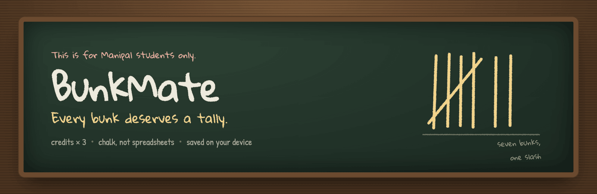
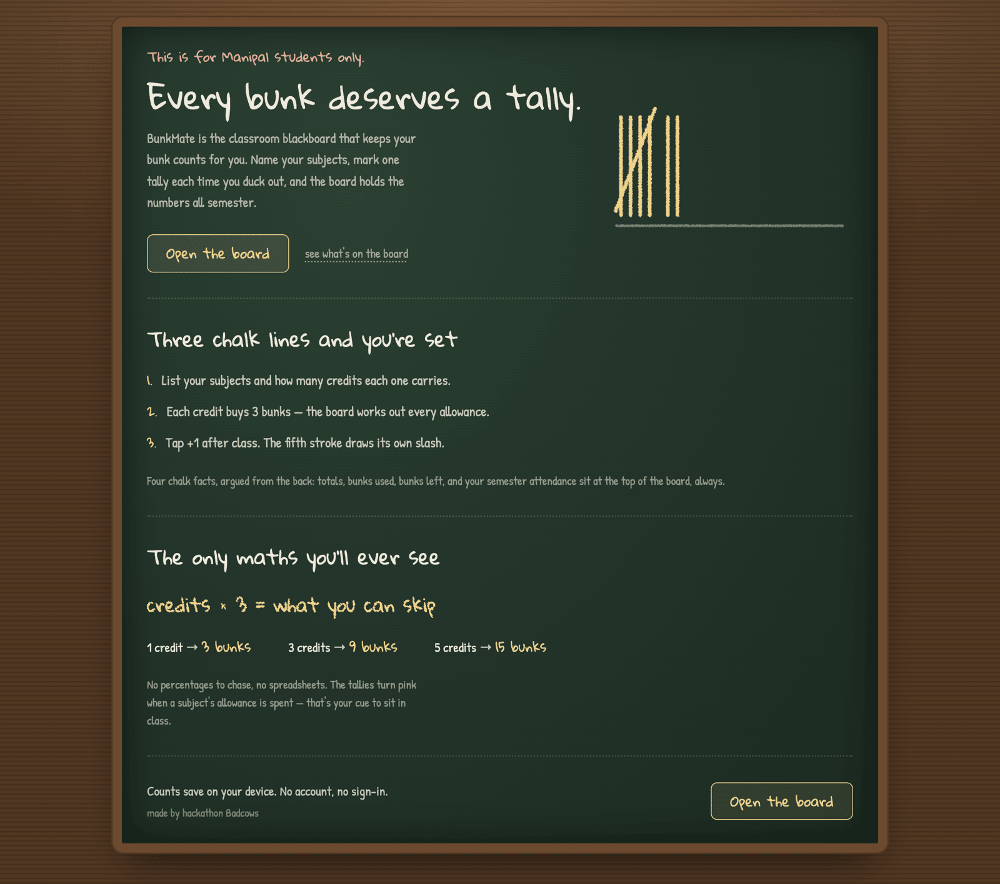
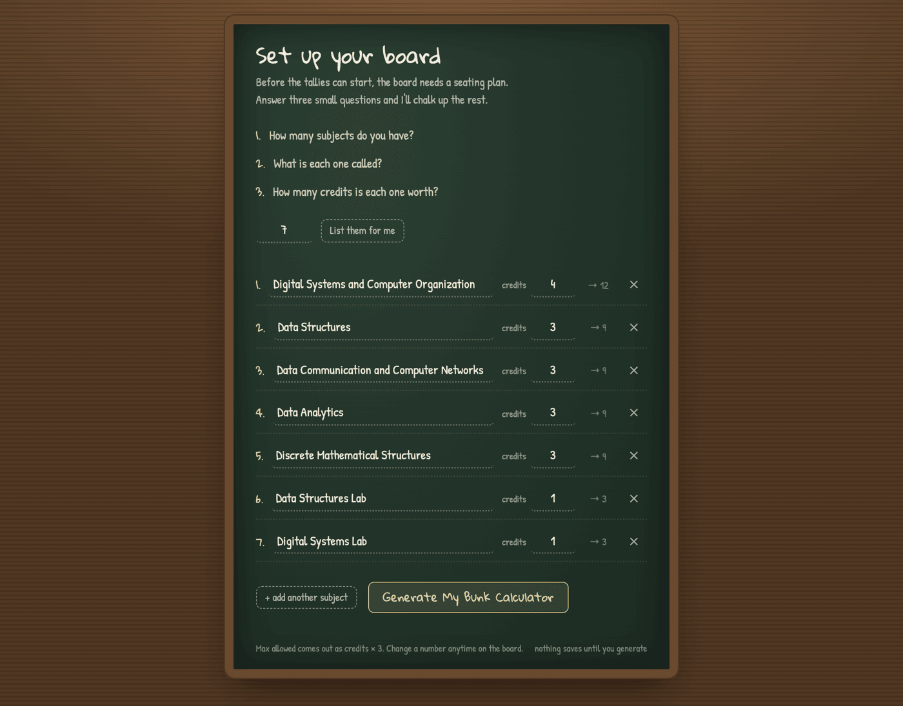
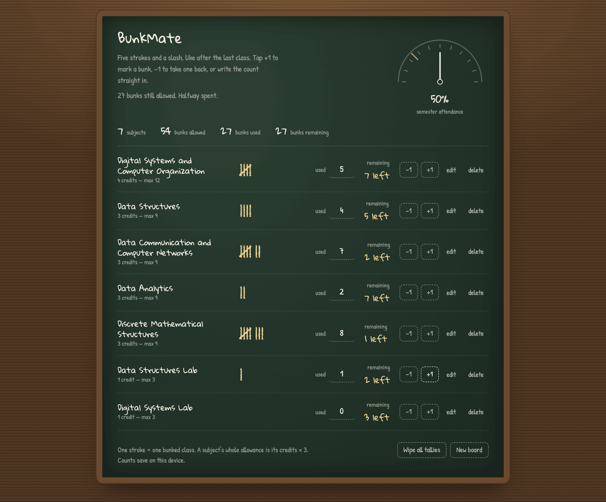
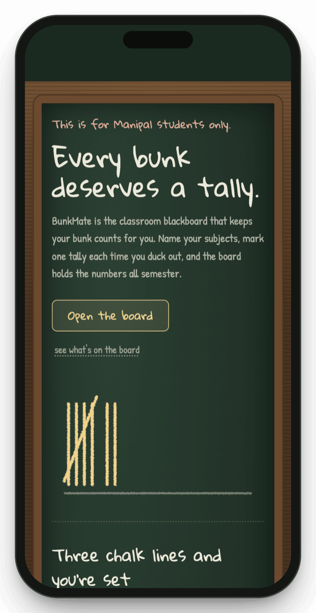

<p align="center">
  
</p>

<p align="center">
  <a href="https://bunkv2.vercel.app"></a>
  
  
  
  
  
</p>

<p align="center">
  <b>Attendance, kept the way a classroom keeps it — in chalk.</b><br />
  <sub>A blackboard for Manipal students. One formula, five strokes and a slash.</sub>
</p>

---

### The short version

> BunkMate is one blackboard, one formula, and a tally for every class you skip.

Most attendance trackers ask you to think in percentages, weeks and thresholds. BunkMate asks for two things — your subjects and their credits — and then behaves like the blackboard at the back of the room: you tap **+1** when you bunk, and a chalk stroke appears.

Every credit buys **3 bunks**. A 3-credit subject gives you 9. When the strokes run out, the board turns pink and tells you to sit in class.

No account, no sign-in, no server. Your counts save in `localStorage`.

<br />

<p align="center">
  
</p>

<p align="center"><sub><i>The landing page — the whole pitch hangs on a single blackboard.</i></sub></p>

<br />

## Three chalk lines and you're set

| &nbsp; | Step | What happens |
| :---: | :--- | :--- |
| **1** | **Name your subjects** | Type how many you have, then each subject and its credit weight. Up to 30. |
| **2** | **The board does the maths** | Each subject's allowance becomes `credits × 3`. Totals appear at the top. |
| **3** | **Tap +1 after class** | One stroke per bunk. The fifth stroke draws its own slash. |

<br />

## The only maths you'll ever see

```text
credits × 3 = what you can skip
```

| Credits | Bunks allowed | Typical course |
| :-----: | :-----------: | :------------- |
| 1 | 3 | Labs, workshops, seminars |
| 3 | 9 | Core theory courses & electives |
| 5 | 15 | Intensive engineering modules |

That's the entire model. No percentage targets, no "you can miss 2 more classes before you're in trouble" arithmetic — the gauge at the top reads the share of your allowance still in hand and calls it **semester attendance**.

<br />

<p align="center">
  
</p>

<p align="center"><sub><i>Setup — seven subjects, seven allowances, worked out while you type.</i></sub></p>

<br />

## The board

<p align="center">
  
</p>

Across the top, four chalk facts: **subjects**, **bunks allowed**, **bunks used**, **bunks remaining** — plus a needle that swings to your attendance. Below them, one row per subject:

- **The tally** — groups of five, the fifth stroke a slash across the other four.
- **The count** — write a number straight in if you'd rather not tap.
- **Remaining** — `7 left`, or `none left, attend!` in pink when the allowance is spent.
- **Controls** — `−1`, `+1`, `edit`, `delete` (delete asks twice).

<br />

<table>
<tr>
<td width="42%" align="center" valign="middle">
  
</td>
<td valign="top">
<br />
<b>Made for the corridor</b>
<br /><br />
Set it up on a laptop the night before the semester, then use it standing outside the classroom.
<br /><br />
The layout collapses to a single column on a phone: gauge first, then the totals, then one compact block per subject — tally, count and buttons all reachable by thumb.
<br /><br />
The strokes never stretch. A group of five still reads as five, at any width.
</td>
</tr>
</table>

<br />

## Everything on the board

| | Feature | What it does |
| :--- | :--- | :--- |
| ✏️ | **Chalk tallies** | Strokes draw themselves in with a hand-drawn filter, one per bunk. |
| 🎮 | **Interactive Sandbox** | Test different courses, tap +1, and watch the chalk draw on the live demo slate. |
| 🔊 | **Tactile Chalk Audio** | Synthesized soft chalk friction sound via Web Audio API with mute toggle. |
| 🔍 | **Formula Inspector** | Interactive slider demonstrating why `Credits × 3` matches the 75% rule. |
| 🔢 | **Type the count** | Junk, negatives and over-allowance numbers are refused — the tally stays honest. |
| ⚖️ | **Edit a subject** | Rename it or change credits. New allowance recalculates instantly; refuses to shrink below bunks used. |
| 🧮 | **Live totals** | Subjects, allowed, used, remaining and the attendance needle update on every tap. |
| 💾 | **Autosave** | Every change is written to `localStorage` under `bunkmate:v1`. Reload and the board is untouched. |
| 🧽 | **Wipe all tallies** | Zero every count without losing the subject list. Asks twice. |
| 🆕 | **New board** | Start a fresh semester. Asks twice. |
| 🚫 | **No duplicates** | `ds` and `DS ` collide — each subject name appears once. |
| ♿ | **Keyboard & motion** | Real labels on every control, polite live regions, and `prefers-reduced-motion` respected throughout. |

<br />

## Built with

| Layer | Choice | Why |
| :--- | :--- | :--- |
| UI | **React 18 + TypeScript** | Small state machine: `landing → setup → board`. |
| Build | **Vite 6** | Instant dev loop, one static bundle. |
| Styling | **Tailwind CSS 4** | Authentic slate blackboard, chalk and wood palette with brass corner accents. |
| Type | **Gloria Hallelujah + Patrick Hand + Caveat** | Chalk lettering that remains legible across mobile & desktop. |
| Audio | **Web Audio API** | Procedural chalk friction noise with zero audio assets. |
| Storage | **`localStorage`** | No backend, no account, no data leaving the device. |
| Hosting | **Vercel** | Static build, deployed live at [bunkv2.vercel.app](https://bunkv2.vercel.app). |

<br />

## Run it locally

```bash
git clone https://github.com/saiujwal-hub/bunkmate.git
cd bunkmate
npm install
npm run dev
```

Open <http://localhost:5199> and click **Open the board**.

| Script | Does |
| :--- | :--- |
| `npm run dev` | Start Vite with hot reload |
| `npm run build` | Type-check with `tsc -b`, then build to `dist/` |
| `npm run preview` | Serve the production build locally |

<br />

## How it's put together

```text
src/
├── App.tsx                  # landing → setup → board, and the autosave
├── components/
│   ├── Landing.tsx          # the redesigned interactive blackboard pitch
│   ├── SetupScreen.tsx      # how many subjects, then names + credits
│   ├── CalculatorScreen.tsx # totals, gauge, rows, reset / new board
│   ├── SubjectRow.tsx       # one subject: tally, count, edit, delete
│   ├── TallyStrokes.tsx     # chalk groups of five
│   ├── GaugeDial.tsx        # attendance needle
│   └── WriteIn.tsx          # chalk that writes itself in
└── lib/
    ├── calc.ts              # credits × 3, clamping, totals, duplicates
    ├── storage.ts           # localStorage read / write / migrate
    └── types.ts             # Subject, SubjectDraft
```

<br />

## Good to know

- **Your data never leaves the browser.** Clearing site data clears the board; there is no server copy to restore it from.
- **Allowance is per subject, not per week.** The model is deliberately simple: `credits × 3` bunks for the semester. It does not know how many classes you actually attended — only how many you've marked.
- **This is for Manipal students only.** The credits × 3 rule comes from there; other colleges may weigh attendance differently.

<br />

---

<p align="center">
  <sub>made by hackathon <b>Badcows</b> · <a href="https://bunkv2.vercel.app">bunkv2.vercel.app</a></sub><br />
  <sub><i>Chalk, not spreadsheets.</i></sub>
</p>
